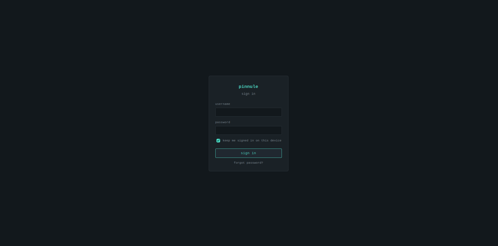
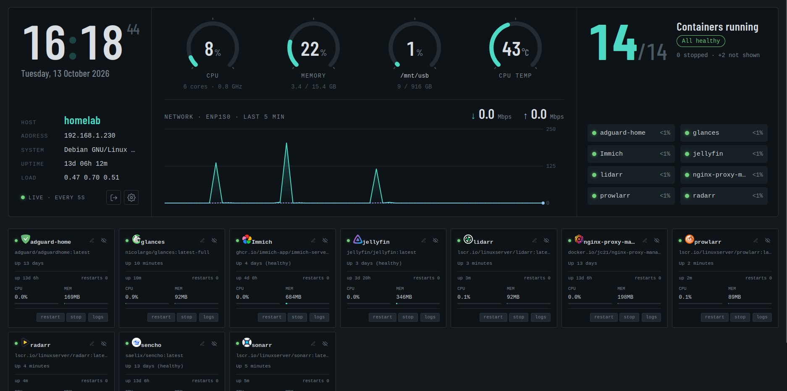
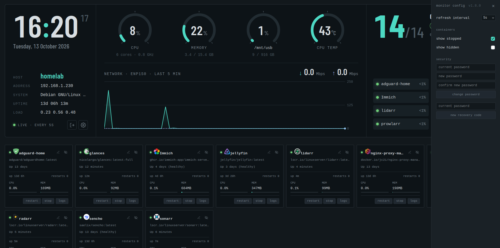
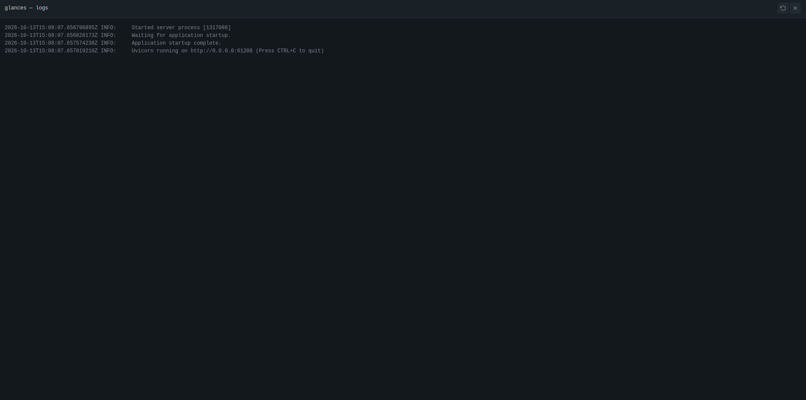

# Pinnule

Current version 1.8.0

**A nimble, lightweight dashboard for your homelab.**

Pinnule is a lightweight front-facing portal that sits on top of your local infrastructure and gives you a clean, real-time view of your Docker containers and host hardware.

It automatically discovers running containers, displays system statistics, and provides quick access to your applications — with minimal configuration if any is required.

<table>
  <tr>
    <td align="center">
      <br>
      <sub>Login Window</sub>
    </td>
    <td align="center">
      <br>
      <sub>Dashboard/sub>
    </td>
    <td align="center">
      <br>
      <sub>Dashboard Menu</sub>
    </td>
    <td align="center">
      <br>
      <sub>Log View</sub>
    </td>
  </tr>
</table>

> **For full transparency this apps code has been built using A.I, full care has been taken to make sure all code is clean and relavent.**
> **The app has been scanned using Trivy and uses a package lock to protect against common vulnerabilities and exposures.**

## Deployment

Pinnule is designed to be simple to deploy using Docker Compose.

### Create the Compose file

Create a directory for Pinnule:

```bash
mkdir -p ~/pinnule
cd ~/pinnule
```

Create `docker-compose.yml`:

```yaml
name: pinnule

services:
  pinnule:
    image: ghcr.io/nikon1977/pinnule:latest
    container_name: pinnule
    restart: unless-stopped
    network_mode: host
    security_opt:
      - no-new-privileges:true
    cap_drop:
      - ALL
    read_only: true
    tmpfs:
      - /tmp
    logging:
      driver: json-file
      options:
        max-size: "10m"
        max-file: "3"
    volumes:
      - /var/run/docker.sock:/var/run/docker.sock:ro
      - pinnule_data:/app/data
      - type: bind
        source: /
        target: /hostfs
        read_only: true
        bind:
          propagation: rslave

volumes:
  pinnule_data:
```

### Start Pinnule

```bash
docker compose up -d
```
Docker will automatically pull the latest Pinnule image from GitHub Container Registry.

Once the container has started, open:

```text
https://SERVER-IP:4443
```
For example:

```text
https://192.168.1.230:4443
```

Pinnule serves itself over HTTPS with a self-signed certificate it generates on first run (and reuses on every restart after that, so your browser's "trust this certificate" exception keeps working). Your browser will warn that the certificate isn't from a recognized authority the first time you connect — that's expected for a self-signed cert on a LAN-only app; proceed past the warning the same way you would for any other self-signed service on your network.
